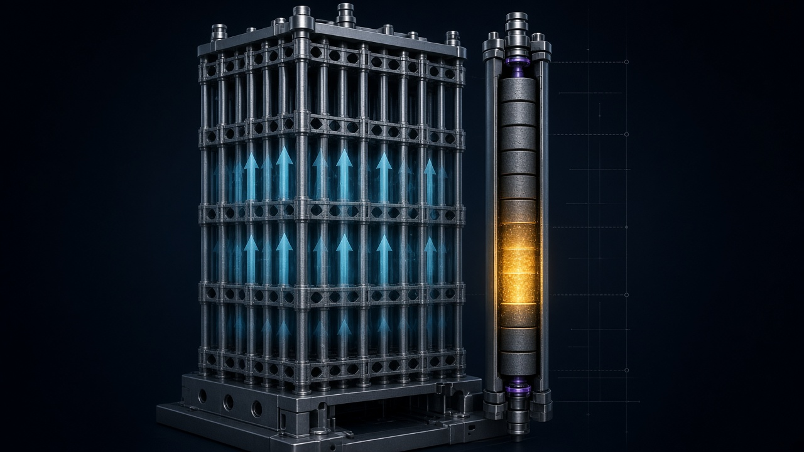

# The Nuclear Fuel Assembly, Explained From the Inside Out

## Rods, ceramic pellets, slowed neutrons, and the lattice that turns a bundle of tubes into a power source

*SEO title: Nuclear Fuel Assembly Explained: Fuel Rods, UO2 Pellets, Cladding, Neutron Moderation, Burnup, and the Reactor Core Lattice*

*Meta description: What a nuclear fuel assembly is, how ceramic UO2 pellets inside sealed cladding become fuel rods, why water slows neutrons so fission can sustain itself, what burnup changes over time, and how assemblies form a reactor core. A plain-language guide with a 34-second animated explainer.*

*Hero image: illustrative cutaway, not a design drawing. The companion animation labels every change of scale, and so does this article.*

---

Most explanations of nuclear fuel start with the wrong object. They start with the reactor, or with fission itself, and the actual piece of hardware that a plant handles, loads, inspects, and replaces gets treated as packaging.

It is not packaging. The fuel assembly is the engineered unit that makes controlled fission practical. It holds fissile material in a fixed geometry, keeps that geometry stable while coolant flows past it, and presents the whole arrangement to the core as one loadable, removable object.

This article walks the same path as the 34-second animation published with it: the assembly from the outside, one rod in section, the neutron physics that the geometry exists to serve, the way the fuel changes with use, and then back out to the lattice. Five scales. One causal chain.

> **A note on limits before we start.** This is a working explainer built on the U.S. Nuclear Regulatory Commission's student reference on nuclear fuel. It uses generic uranium dioxide ceramic throughout. It gives no enrichment figures, no dimensions, no temperatures, and no failure analysis, because a general explainer has no business inventing precision it cannot source. Where a mechanism cannot be drawn honestly at this scale, the animation says so and switches to a labeled schematic. Details for any specific reactor must be verified against that reactor's documentation before publication or use.

## 1. What a fuel assembly actually is

Strip away the context and a fuel assembly is a bundle of long, thin tubes held parallel to each other in a regular pattern, with structural pieces at the top and bottom that let the whole bundle be lifted, positioned, and locked into place as a single object.

Those tubes are the **fuel rods**. Each one is sealed, and each one contains the actual fuel. The bundle is not held together by the rods pressing against each other. It is held together by **spacer grids**, flat lattice structures spaced along the bundle's length that each rod passes through. The grids do three jobs at once. They maintain the spacing between rods, they keep the rods aligned over the full length of the assembly, and they preserve the open channels between rods that coolant needs in order to flow through the bundle.

At the ends, **nozzles** close the structure. They are the handling and seating interfaces between the assembly and the rest of the core.

That is the entire macro-scale idea, and it is worth pausing on why it is shaped this way. Fission is not controlled by the fuel alone. It is controlled by geometry, by what sits between the fuel surfaces, and by how predictably that arrangement repeats. An assembly is a way of manufacturing that repeatability. Instead of asking an operator to arrange hundreds of individual rods inside a reactor, the industry arranges them once, at the factory, into a unit whose geometry is already correct.

### Why the channels between rods matter as much as the rods

It is tempting to read the assembly as fuel with structure around it. Read it the other way and it gets more accurate. The spaces between rods are functional volume. Coolant moves through those channels, carrying heat away from the rod surfaces. The same water that cools the rods also does a second job, slowing neutrons, which is the subject of section 3. The assembly is therefore not just a container. Its spacing is part of the physics.

## 2. Inside one rod: pellets, cladding, and a deliberate empty space

Cut one rod along its length and the interior is almost disappointingly simple. That simplicity is the point.

The fuel itself is a stack of **ceramic pellets** made of uranium dioxide, UO2. Each pellet is a short cylinder. Stacked end to end, the pellets fill most of the rod's length. Ceramic is doing specific work in this choice of form. UO2 in ceramic form holds its shape at the temperatures inside an operating rod, retains much of what fission produces inside its own material, and can be manufactured as identical, inspectable units. A pellet is a countable thing. A stack of pellets is a measurable thing. That measurability is a safety feature in itself, even before any physics enters the picture.

Around the stack is the **cladding**, the rod's sealed tube wall. The cladding is the boundary between the fuel and the coolant. It keeps the pellet stack in place, gives the rod its structural form, and prevents the fuel and the products created inside the pellets from mixing directly with the water flowing past the rod.

Two details of the rod interior deserve attention because both look like waste and neither is.

The first is the thin **gap between the pellet stack and the cladding wall**. In drawings it is usually exaggerated, and the animation exaggerates it too while labeling that it has done so. The gap exists because materials inside an operating rod do not stay exactly the size they were on the day they were manufactured. Clearance is planned, not accidental.

The second is the empty region at the top of the rod, the **plenum**, which in many designs contains a spring that keeps the pellet stack seated. Fission inside a sealed tube generates gas over time. A sealed system that generates gas needs somewhere planned for that gas to go. The plenum is that somewhere. Again, planned volume, not leftover volume.

The discipline running through the whole rod is worth naming. Nothing in the section depends on parts being forced into contact. Pellets, gap, cladding, plenum, and spring each have a role, and the drawing can assign each role a label without any piece pretending to do another piece's job.

## 3. Moderation: the reason the water is there twice

Fission, at the level this article needs, is a heavy nucleus splitting after absorbing a neutron, releasing energy, fission fragments, and additional neutrons. Those new neutrons are what make a chain reaction conceivable. They are also, at the moment of their birth, moving too fast to sustain that chain efficiently in this kind of reactor.

That mismatch is the central problem the assembly's water channels solve.

A neutron released by fission is a **fast neutron**. When it collides with the light nuclei in water, it gives up energy with each collision, the way a moving ball loses speed across repeated impacts with lighter balls. After enough collisions it has slowed to the energy range of the surrounding material's thermal motion. At that point it is a **thermal neutron**. A thermal neutron is far more likely to be absorbed by a fissile nucleus in a pellet and cause another fission.

Water in and around the assembly is therefore doing two jobs with one presence. As **coolant**, it carries heat away from rod surfaces. As **moderator**, it slows neutrons into the range where the fuel can use them. The term for the slowing process is moderation, and it is the reason the spacing set by those spacer grids is physics, not tidiness. Too little water between rods and neutrons are not slowed enough. The geometry and the neutron behavior are one system.

The animation renders this phase as an explicitly labeled schematic, and the label matters. A real neutron's history involves distances and times that no 34-second stage can represent at scale, and the drawing does not pretend otherwise. Distances, energies, and timing in that segment are not to scale. What the schematic preserves is the causal order, which is the part a first model needs. Fast neutron. Collisions with water. Energy lost step by step. Thermal neutron. Absorption in a pellet. Fission, with energy and fresh neutrons as the output, ready to begin the same sequence again.

Get that order right and the rest of reactor behavior becomes easier to reason about, because so much of it is the management of exactly this loop.

## 4. Burnup: the fuel at the end is not the fuel at the start

Load a fresh assembly and its pellets contain the full fissile inventory they will ever have. From the first day of operation, that inventory is being spent.

**Burnup** is the name for the cumulative extent of that spending. As fission proceeds, fissile nuclei are consumed. At the same time, the fragments produced by fission, the **fission products**, accumulate inside the pellet material. Some of those products absorb neutrons without producing fission in return, which makes them quiet competitors for the very neutrons the chain reaction needs.

The combined result is a gradual decline. An assembly that begins life contributing strongly to the core's output contributes less as its fissile content falls and its accumulated fission products rise. This is not damage. It is the expected trajectory of the fuel, and reactor fuel management is largely the discipline of planning around it: where assemblies sit in the lattice, how long they remain, and when they are discharged and replaced.

The animation shows this phase qualitatively, and the absence of numbers in that segment is a deliberate editorial choice rather than missing data. Burnup values, cycle lengths, and discharge criteria are specific to a fuel design and a plant's operating strategy. A general explainer that printed a figure would be inventing a specification. What a first model needs is direction, not a rate. Fissile content goes down over time in the core. Fission products build up. Relative output falls. Those three sentences are the honest version of the graph.

There is a useful mental habit here that extends well beyond nuclear fuel. When a system changes state slowly and irreversibly during normal operation, the correct diagram is often a direction with labeled causes, not a curve with borrowed numbers. Precision that cannot be sourced is not rigor. It is decoration with units attached.

## 5. Back out: the assembly only matters inside the lattice

The final movement of the animation reverses the first. The single assembly shrinks back into a grid of its peers, the **core lattice**, and the things that were background become system again. Coolant pathways now run through an entire core rather than one bundle. Sensing points, shown schematically, mark where a system of this kind watches its own state.

This pull-back is not a cinematic courtesy. It is where the explanation becomes true. No assembly operates alone. Its output depends on its neighbors, on its position in the lattice, and on the shared coolant and sensing environment. The rod section explained where fission happens. The lattice is where fission becomes a managed power source rather than a physical event.

That is the complete chain the 34 seconds carry. A manufactured bundle holds geometry steady. Inside each rod, a ceramic stack waits inside a sealed boundary with planned room for change. Water between the rods cools the surfaces and slows neutrons until the fuel can use them. Use itself consumes the fuel on a predictable downward trajectory. And the lattice turns all of it into a system that can be loaded, monitored, and eventually refueled as a system.

## What this explainer refuses to do, and why that is the feature

Three refusals run through both the animation and this article, and they are worth stating plainly because they are the difference between an explainer and a rendering.

First, **no invented specifications**. No dimensions, enrichment values, temperatures, or performance figures appear, because none were supplied by the source material at the level of generality this piece operates at. The NRC reference supports the architecture and the process. It does not turn a general explainer into a design document, and the piece does not borrow authority it has not earned.

Second, **no silent changes of scale**. Every jump in the animation, assembly to rod, rod to schematic, schematic to time, time to core, is announced on the stage itself. A viewer should never have to guess whether they are looking at a meter or a micron. The moment an explainer lets a schematic and a structure share a visual language without a label, it starts teaching a false model with high production values.

Third, **no physics the drawing cannot support**. Where the mechanism can be shown, it is shown. Where it cannot, the stage says "schematic" and shows the causal order instead. That is not a lesser choice. It is the choice that keeps the true parts believable.

## How to use the 34 seconds

Watch it once without touching anything. The five phases are timed to be read in sequence, and the end holds on the complete core so the final image is the system, not a detail.

Then scrub it. The timeline is deterministic, which means frame 412 always draws the same moderation schematic and frame 900 always draws the same lattice. That property makes the animation usable in a classroom or a review in a way a looping GIF is not. Pause in the rod section and ask what the plenum is for. Pause on the qualitative burnup curve and ask why it has no numbers. Pause on the labeled schematic and ask what "not to scale" is protecting.

An explainer that survives being paused and questioned has done its job. One that only works at full speed has done a different job, and it is worth knowing which of the two you are publishing.

## Sources

- U.S. Nuclear Regulatory Commission, "Nuclear Fuel," student reference, Basic References. https://www.nrc.gov/reading-rm/basic-ref/students/fuel.html

*Working brief, not a certified engineering reference. Camera moves, palette, cutaways, and timing in the companion animation are original illustrative directions. Verify subject-specific details against plant and fuel-vendor documentation before publication or operational use.*

---

**About this piece.** Kinetic Gain LLC builds evidence-graded technical explainers in which every simplification is labeled on the surface it appears on. The companion explainer, its still diagram, and its system mindmap are published with this article. Reuse note: the same five-phase camera grammar, macro to micro to schematic to time to system, transfers directly to a steam generator, a turbine stage, or a spent-fuel cask. Swap the hardware. Keep the labeling discipline.

*Tags: nuclear energy, nuclear fuel, fuel assembly, uranium dioxide, neutron moderation, burnup, reactor core, engineering education, science communication*
